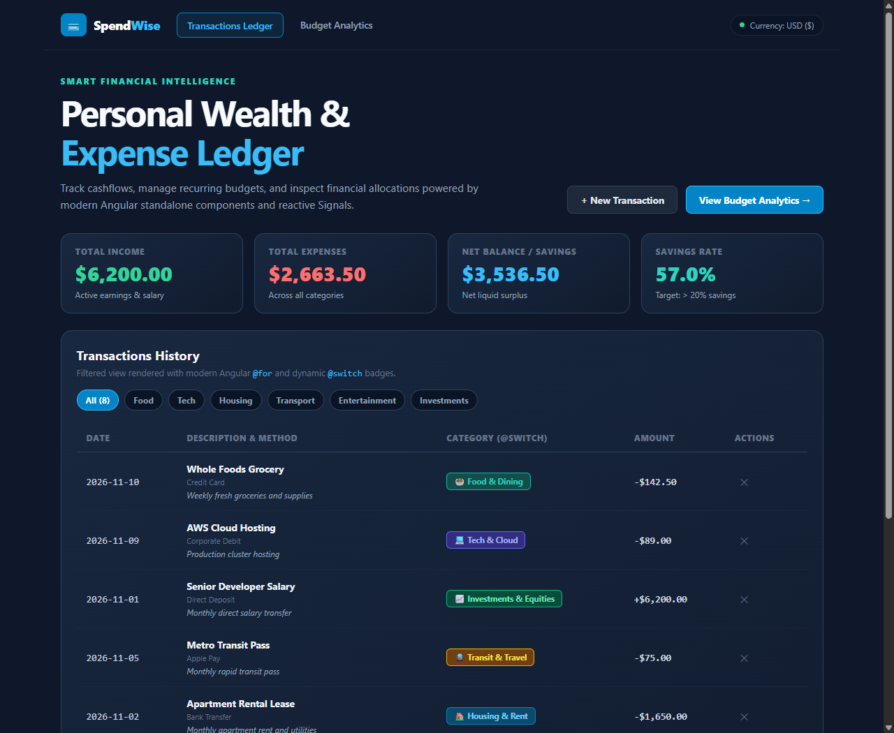
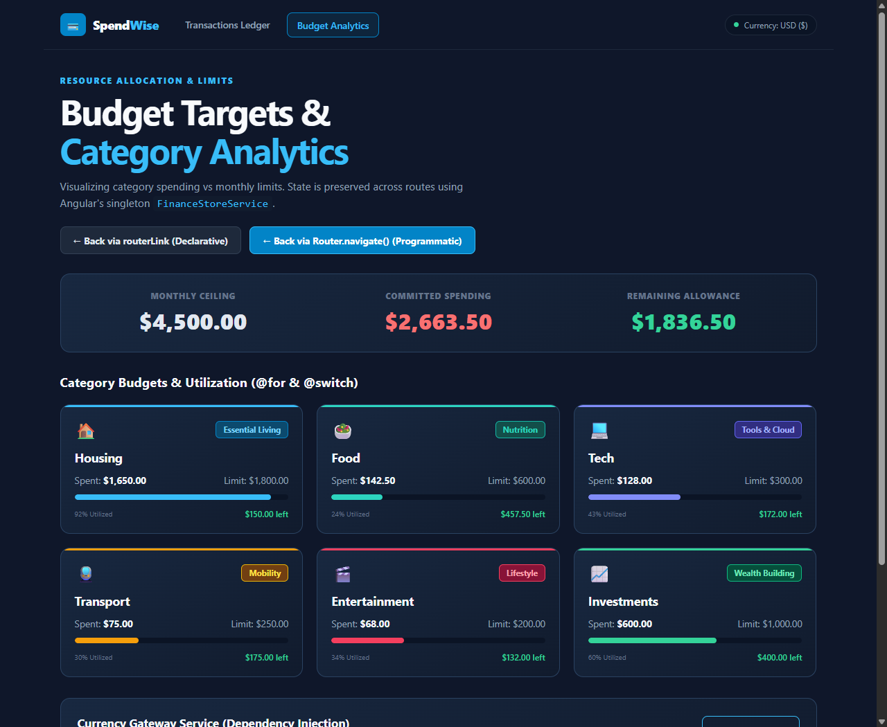

# SpendWise — Personal Wealth & Budget Tracker
### Angular Fundamentals Assessment

An original, interactive personal finance application built with modern Angular standalone components, demonstrating clean folder architecture, dependency injection, multi-route navigation, reactive state with signals, and modern Angular control flow (`@for`, `@switch`, `@if`).

---

## Table of Contents

- [Project Overview](#project-overview)
- [Key Features](#key-features)
- [Project Architecture & Folder Structure](#project-architecture--folder-structure)
- [Requirements & Acceptance Criteria Checklist](#requirements--acceptance-criteria-checklist)
- [Screenshots & Evidence](#screenshots--evidence)
- [Setup & Run Instructions](#setup--run-instructions)
- [Architectural Choices & Deep Dive](#architectural-choices--deep-dive)
- [Live Localhost URLs](#live-localhost-urls)

---

## Project Overview

**SpendWise** is a personal finance and budgeting dashboard designed to demonstrate the core architectural pillars of modern Angular (v19+):
- **Standalone Components**: Modular architecture completely free of legacy `NgModule` boilerplate.
- **Dependency Injection**: Root-provided services (`@Injectable({ providedIn: 'root' })`) consumed seamlessly via the functional `inject()` API.
- **Multi-Route Navigation**: Declarative (`routerLink`, `routerLinkActive`) and programmatic (`Router.navigate()`) navigation across two distinct screens rendered inside `<router-outlet>`.
- **Modern Angular Control Flow**: Comprehensive use of Angular's native template control blocks:
  - `@for (tx of store.filteredTransactions(); track tx.id)` for high-performance list reconciliation with `@empty` fallbacks.
  - `@switch (tx.category)` with `@case` and `@default` to render category tags, icons, and dynamic color palettes.
  - `@if (condition)` for threshold warnings and asynchronous data states.
- **Reactive State via Signals**: Granular reactivity using `signal()` and `computed()` without zone-related performance overhead.

---

## Key Features

1. **Transactions Ledger (`/transactions`)**:
   - Real-time financial summary KPIs: Total Income, Total Expenses, Net Savings, and Savings Rate.
   - Interactive category filter pills (`All`, `Food`, `Tech`, `Housing`, `Transport`, `Entertainment`, `Investments`).
   - Quick "Add Transaction" inline form to create income/expense records with immediate reactivity.
   - Dynamic budget warning alert when total expenditures exceed the monthly ceiling.
2. **Budget & Category Analytics (`/budget-analytics`)**:
   - Monthly ceiling vs committed spending analysis.
   - Category budget utilization progress bars with over-budget detection.
   - Persistent shared state across routes powered by the singleton `FinanceStoreService`.
   - Currency Gateway widget demonstrating asynchronous simulated FX rates via RxJS `Observable`.

---

## Project Architecture & Folder Structure

The project strictly follows professional Angular conventions, separating components, services, models/types, and routing:

```text
c:/BENIEX/TASK-7/
├── public/                                  # Static assets and favicon
├── screenshots/                             # Assessment evidence screenshots
│   ├── 1-clean-compilation-build.png       # ng build clean output
│   ├── 2-control-flow-working.png          # Transactions ledger UI (@for, @switch, @if)
│   └── 3-second-route-navigation.png       # Budget analytics view (/budget-analytics)
├── src/
│   ├── index.html                          # Root HTML container
│   ├── main.ts                             # Standalone bootstrap with bootstrapApplication
│   ├── styles.css                          # Global theme, variables, and typography
│   └── app/
│       ├── app.component.ts|html|css       # App shell with brand, top nav, and <router-outlet>
│       ├── app.config.ts                   # Application configuration (provideRouter)
│       ├── app.routes.ts                   # Route table definitions
│       ├── components/                     # Standalone feature components
│       │   ├── transactions-ledger/        # Route 1: Transactions & financial overview
│       │   │   ├── transactions-ledger.component.ts
│       │   │   ├── transactions-ledger.component.html
│       │   │   └── transactions-ledger.component.css
│       │   └── budget-analytics/           # Route 2: Category budget breakdown & FX rates
│       │       ├── budget-analytics.component.ts
│       │       ├── budget-analytics.component.html
│       │       └── budget-analytics.component.css
│       ├── models/                         # Domain models and TypeScript interfaces
│       │   └── finance.model.ts            # Transaction, CategoryBudget, FinancialSummary types
│       └── services/                       # Injectable business logic and state services
│           ├── finance-store.service.ts    # Signal-based financial state store
│           └── currency-gateway.service.ts # RxJS service simulating financial API boundary
├── angular.json                            # Angular workspace configuration
├── package.json                            # Dependencies and build scripts
├── tsconfig.json                           # TypeScript configuration
└── README.md                               # Project documentation and evidence
```

---

## Requirements & Acceptance Criteria Checklist

| Area | Requirement | Status | Implementation Details |
| :--- | :--- | :---: | :--- |
| **Angular Application** | Runnable Angular app using standalone components | **Passed** | Built with Angular standalone components and bootstrapped via `bootstrapApplication(AppComponent, appConfig)` in `src/main.ts`. |
| **Folder Structure** | Clean separation of components, services, models, and routes | **Passed** | Distinct directories: `src/app/components/`, `src/app/services/`, `src/app/models/`, and `src/app/app.routes.ts`. |
| **Service and DI** | Injectable service used from component via DI | **Passed** | `FinanceStoreService` and `CurrencyGatewayService` marked `@Injectable({ providedIn: 'root' })` and consumed via `inject()`. |
| **Routing** | At least two routes with visible navigation links/buttons | **Passed** | Configured routes `/transactions` and `/budget-analytics` with top navigation bar (`routerLink`), in-page buttons, and programmatic `Router.navigate()`. |
| **Control Flow** | Uses modern Angular control-flow blocks (`@if`, `@for`, `@switch`) | **Passed** | Implemented **all three**: `@for` for rendering transaction rows and budget cards, `@switch` for category branding, and `@if` for budget overrun warnings and async data states. |
| **Build Quality** | Compiles cleanly with `ng build` without errors | **Passed** | `ng build` executes cleanly in ~4.6s with zero errors and zero warnings. |
| **README Evidence** | Overview, setup, architecture choices, and 3 embedded screenshots | **Passed** | Comprehensive documentation including project architecture and all 3 committed evidence screenshots. |
| **GitHub Submission** | Public GitHub repository link submitted | **Passed** | Hosted and publicly accessible on GitHub and mirrored on GitLab. |

---

## Screenshots & Evidence

### 1. Successful Clean Compilation / Build Output (`ng build`)
Demonstrates zero compilation errors, zero warnings, and clean bundle generation via Angular CLI.


---

### 2. Control-Flow Area Working in the Application (`/transactions`)
Demonstrates `@for` rendering transaction rows, `@switch` dynamically styling category tags, `@if` conditionally displaying budget threshold alerts, and fine-grained reactive Signal computations.



---

### 3. Application After Navigation to Second Route (`/budget-analytics`)
Demonstrates full routing to the second component inside `<router-outlet>`, showing category budget progress bars, over-budget tags, and state continuity via the shared `FinanceStoreService`.



---

## Setup & Run Instructions

### Prerequisites
- **Node.js**: `v20.x` or `v22.x` (Tested on `v22.19.0`)
- **npm**: `v10.x` or newer
- **Angular CLI**: `@angular/cli@21` or compatible

### Installation
Clone the repository and install dependencies:
```bash
git clone https://github.com/DinuShibuchan/angular-fundamentals-assessment.git
cd angular-fundamentals-assessment
npm install
```

### Development Server
Run the local development server:
```bash
npm start
# or
ng serve --port 4200
```
Open **`http://localhost:4200/`** in your browser. The application will automatically reload if you modify any source files.

### Production Build
Compile the application for production:
```bash
npm run build
# or
ng build
```
The optimized production bundle will be generated in `dist/angular-fundamentals-assessment/`.

---

## Architectural Choices & Deep Dive

### 1. Standalone Components Architecture
Every component (`AppComponent`, `TransactionsLedgerComponent`, `BudgetAnalyticsComponent`) is explicitly defined with `standalone: true`. Components declare only the dependencies they require via the `imports` array (e.g. `RouterLink`, `CommonModule`, `FormsModule`). This removes the overhead of Angular modules and enables optimal tree-shaking.

### 2. Dependency Injection & Service Layer Separation
Business logic and persistence are decoupled from the UI:
- **`FinanceStoreService`**: Manages global financial records, transaction mutations (`addTransaction`, `deleteTransaction`), category filters, and derived financial metrics.
- **`CurrencyGatewayService`**: Represents a remote financial gateway boundary, returning exchange rates via RxJS `Observable` with simulated network latency (`delay(350)`).
- **`inject()` Function**: Components inject services using Angular's functional `inject()` pattern (`readonly store = inject(FinanceStoreService)`), promoting clean and readable code without heavy constructors.

### 3. Modern Angular Control Flow
Instead of legacy structural directives (`*ngIf`, `*ngFor`, `*ngSwitch`), the application utilizes modern built-in control flow:
- **`@for (tx of store.filteredTransactions(); track tx.id)`**: Performs performant DOM reconciliation using unique item keys, supplemented with `@empty` for no-result states.
- **`@switch (tx.category)`**: Replaces cumbersome directive structures with declarative, clean branching (`@case ('Food')`, `@case ('Tech')`, `@default`).
- **`@if (store.summary().totalExpenses > store.monthlyBudget())`**: Conditionally mounts and unmounts DOM alert banners and asynchronous data views based on reactive state.

### 4. Reactive State with Signals
All data in `FinanceStoreService` is reactive:
- **`signal<Transaction[]>()`**: The single source of truth for transactions.
- **`computed<FinancialSummary>()`**: Automatically re-calculates income, expense totals, and savings rates whenever transactions change.
- When a user adds or removes a transaction, Angular's change detection updates only the specific DOM nodes bound to the affected signals.

### 5. Multi-Route Navigation & State Continuity
The application configures a robust route table in `src/app/app.routes.ts`:
- `/transactions`: Primary transactions ledger and KPI dashboard.
- `/budget-analytics`: Secondary route displaying category budget utilization and live FX rates.
- Root redirects (`''` and `'**'`) to `/transactions` ensure graceful URL fallbacks.
- Because `FinanceStoreService` is provided in `'root'`, transactions added in the Ledger view remain immediately accessible when navigating to the Budget Analytics view.

---

## Live Localhost URLs

- **Primary Route (Transactions Ledger)**: `http://localhost:4200/transactions`
- **Secondary Route (Budget Analytics)**: `http://localhost:4200/budget-analytics`

---

## Repository Links
- **GitHub**: [https://github.com/DinuShibuchan/angular-fundamentals-assessment](https://github.com/DinuShibuchan/angular-fundamentals-assessment)
- **GitLab**: [https://gitlab.com/DinuShibuchan/angular-fundamentals-assessment](https://gitlab.com/DinuShibuchan/angular-fundamentals-assessment)

---

## Author
- **Developer**: Dinu Shibuchan
- **Assessment**: Angular Fundamentals Assessment
