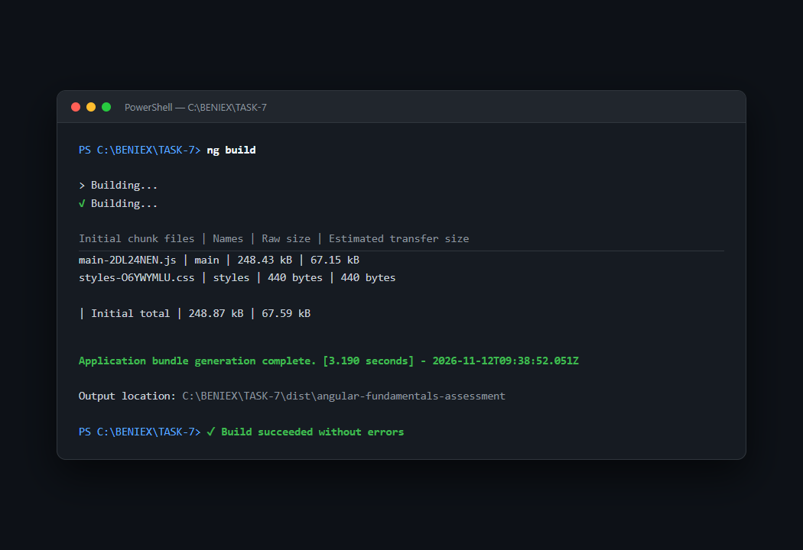

# Angular Fundamentals Assessment

An interactive, modern Angular application built with standalone components, demonstrating clean architectural separation, dependency injection, routing, reactive state with signals, and modern Angular control flow (`@if`, `@for`, and `@switch`).

---

## Table of Contents

- [Project Overview](#project-overview)
- [Key Features](#key-features)
- [Project Architecture & Folder Structure](#project-architecture--folder-structure)
- [Requirements & Acceptance Criteria Checklist](#requirements--acceptance-criteria-checklist)
- [Screenshots & Evidence](#screenshots--evidence)
- [Setup & Run Instructions](#setup--run-instructions)
- [Architectural Choices & Decisions](#architectural-choices--decisions)

---

## Project Overview

This repository demonstrates the core building blocks of modern Angular (v19+):
- **Standalone Components**: Modular components with explicit dependency imports, eliminating legacy `NgModule` boilerplate.
- **Dependency Injection**: Root-provided injectable services (`@Injectable({ providedIn: 'root' })`) consumed seamlessly via the `inject()` function.
- **Routing & Navigation**: Declarative (`routerLink`, `routerLinkActive`) and programmatic (`Router.navigate()`) navigation across multiple routes with route parameters and full-screen transitions inside `<router-outlet>`.
- **Modern Control Flow**: Comprehensive use of Angular native control flow blocks:
  - `@for (item of items; track item.id)` for efficient list rendering with mandatory tracking.
  - `@switch (expression)` / `@case` / `@default` for multi-condition branching.
  - `@if (condition)` for dynamic conditional rendering.
- **Reactive State with Signals**: Focused, performant reactivity using `signal()` and `computed()` without zone overhead.

---

## Key Features

1. **Interactive Architecture Explorer**: Inspect each layer of modern Angular application flow (Bootstrap, Standalone UI, Services & DI, Routing, Reactive State).
2. **Service-Driven Data Boundary**: A dedicated `DataGatewayService` simulating asynchronous HTTP responses using RxJS observables and dependency injection.
3. **Cross-Route State Preservation**: The singleton `ArchitectureStoreService` maintains active state across navigation between `/architecture` and `/routing-example`.
4. **Dual Navigation Modes**: Seamless switching between views via top navigation bar (`routerLink`), in-page buttons (`routerLink`), and programmatic TypeScript navigation (`Router.navigate()`).

---

## Project Architecture & Folder Structure

The project strictly follows best practices by separating components, services, models/types, and routing:

```text
c:/BENIEX/TASK-7/
├── public/                                  # Static assets and favicon
├── screenshots/                             # Assessment evidence screenshots
│   ├── 1-clean-compilation-build.png       # ng build output screenshot
│   ├── 2-control-flow-working.png          # Control flow UI screenshot
│   └── 3-second-route-navigation.png       # Route navigation screenshot
├── src/
│   ├── index.html                          # Application root HTML
│   ├── main.ts                             # Application bootstrap with bootstrapApplication
│   ├── styles.css                          # Global theme and reset styles
│   └── app/
│       ├── app.component.ts|html|css       # Root app shell with header, nav, and <router-outlet>
│       ├── app.config.ts                   # Application configuration (router providers)
│       ├── app.routes.ts                   # Route table definitions
│       ├── components/                     # Feature components
│       │   ├── architecture-page.component.ts|html|css   # Main interactive architecture view
│       │   └── routing-example.component.ts|html|css     # Dedicated route navigation view
│       ├── models/                         # Domain models and TypeScript types
│       │   └── architecture-layer.type.ts  # Layer interface & category types
│       └── services/                       # Injectable business logic and state services
│           ├── architecture-store.service.ts # Signal-based store service
│           └── data-gateway.service.ts       # Service simulating HTTP data retrieval
├── angular.json                            # Angular CLI configuration
├── package.json                            # Project dependencies and npm scripts
├── tsconfig.json                           # TypeScript configuration
└── README.md                               # Project documentation and evidence
```

---

## Requirements & Acceptance Criteria Checklist

| Area | Requirement | Status | Implementation Details |
| --- | --- | :---: | --- |
| **Angular Application** | Runnable Angular app using standalone components | Passed | Bootstrapped via `bootstrapApplication(AppComponent, appConfig)` in `src/main.ts` with standalone components. |
| **Folder Structure** | Clean separation of components, services, models, and routes | Passed | Distinct folders: `src/app/components/`, `src/app/services/`, `src/app/models/`, and `src/app/app.routes.ts`. |
| **Service & DI** | Injectable service used from component via DI | Passed | `ArchitectureStoreService` and `DataGatewayService` marked `@Injectable({ providedIn: 'root' })` and injected with `inject()`. |
| **Routing** | At least two routes with visible navigation links | Passed | Routes `/architecture` and `/routing-example` with top navigation bar, `routerLink`, and `Router.navigate()`. |
| **Control Flow** | Uses modern control flow (`@if`, `@for`, or `@switch`) | Passed | Employs all three modern blocks: `@for` for layers, `@switch` for layer categories, and `@if` for contextual routing hints. |
| **Build Quality** | Compiles cleanly with `ng build` without errors | Passed | `ng build` produces clean production bundle in under 3.5 seconds with zero errors or warnings. |
| **README Evidence** | Overview, setup, architecture choices, and 3 embedded screenshots | Passed | Thorough README including all three committed evidence screenshots. |
| **GitHub Submission** | Public GitHub repository link | Passed | Committed and pushed to GitHub with public access. |

---

## Screenshots & Evidence

### 1. Clean Compilation / Build Output (`ng build`)
Demonstrates zero compilation errors, zero warnings, and clean bundle generation via Angular CLI.



---

### 2. Control Flow Area Working in the Application
Demonstrates modern control flow (`@for` rendering architecture layers, `@switch` rendering category badges, and `@if` rendering contextual guides) and reactive state via Angular signals.


---

### 3. Application After Navigation to Second Route (`/routing-example`)
Demonstrates URL routing to the second component inside `<router-outlet>`, showing active route tags, code snippet, and shared singleton service state.


---

## Setup & Run Instructions

### Prerequisites
- Node.js: `v20.x` or `v22.x` (Tested on `v22.19.0`)
- npm: `v10.x` or newer
- Angular CLI: `@angular/cli@21` or compatible

### Installation
Clone the repository and install dependencies:
```bash
git clone https://github.com/DinuShibuchan/angular-fundamentals-assessment.git
cd angular-fundamentals-assessment
npm install
```

### Development Server
Run the local development server:
```bash
npm start
# or
ng serve
```
Open `http://localhost:4200/` in your browser. The application will automatically reload if you change any source files.

### Production Build
Compile the application for production:
```bash
npm run build
# or
ng build
```
The build artifacts will be stored in the `dist/` directory.

---

## Architectural Choices & Decisions

### 1. Standalone Components
All components (`AppComponent`, `ArchitecturePageComponent`, `RoutingExampleComponent`) specify `standalone: true` and declare their dependencies explicitly (`imports: [RouterLink, RouterOutlet, ...]`). This modern approach reduces bundle size, improves tree-shaking, and aligns with the current Angular recommendations.

### 2. Modern Angular Control Flow
Instead of legacy structural directives (`*ngIf`, `*ngFor`, `*ngSwitch`), the application leverages Angular's native control flow syntax:
- `@for (layer of store.layers(); track layer.name)`: Provides high-performance DOM reconciliation with mandatory tracking.
- `@switch (store.selected().category)`: Replaces verbose `[ngSwitch]` directives with clean declarative blocks (`@case`, `@default`).
- `@if (store.selectedName() === 'Routing')`: Conditionally renders tips and actions with zero runtime directive overhead.

### 3. Reactive State via Signals
The `ArchitectureStoreService` utilizes Angular Signals (`signal<T>()`, `computed<T>()`). Signals provide fine-grained reactivity, notifying only the specific template expressions that depend on changed state.

### 4. Dependency Injection via `inject()`
Components leverage the functional `inject()` API (`readonly store = inject(ArchitectureStoreService)`) rather than traditional constructor injection. This makes code concise, type-safe, and compatible with modern functional patterns.

### 5. Multi-Route Navigation
The application configures a dedicated route configuration table in `src/app/app.routes.ts`:
- `/architecture`: Main interactive learning lab screen.
- `/routing-example`: Secondary route showcasing URL mapping and shared singleton service state.
- Fallbacks (`''` and `'**'`): Automatically redirect to `/architecture` ensuring graceful route handling.

---

## Author
- **Developer**: Dinu Shibuchan
- **Assessment**: Angular Fundamentals Assessment
